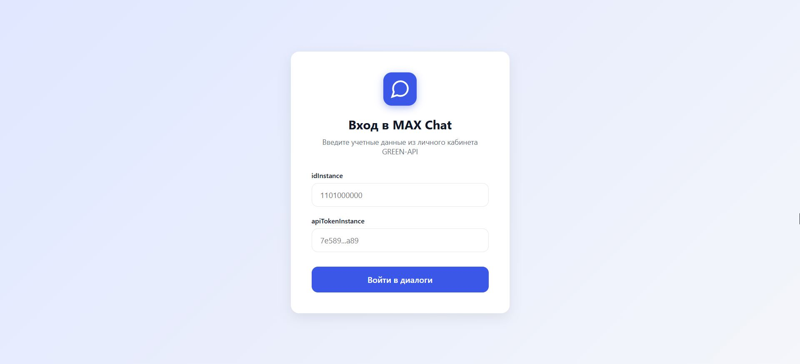
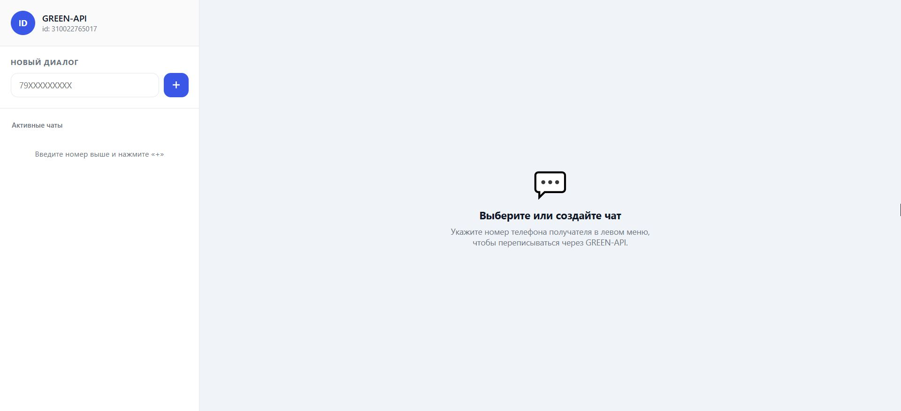
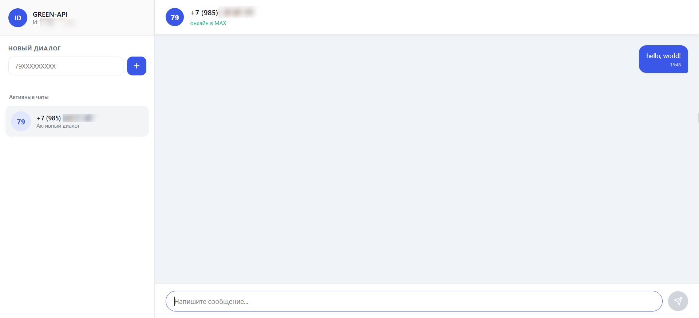

# GREEN-API React Chat

Веб-интерфейс для отправки и получения текстовых сообщений через GREEN-API.

[## 📽️ Видеопрезентация](preview/preview.mp4)

## 📸 Скриншоты

<p align="center">
  
  
  
</p>

## Запуск локально

1. Клонировать репозиторий:
    ```bash
    git clone <ссылка_на_ваш_репозиторий>
    cd green-api-chat
    ```

2. Установить зависимости:
    ```bash
    npm install
    ```

3. Запустить проект:
    ```bash
    npm run dev
    ```

4. Открыть в браузере по адресу http://localhost:5173
